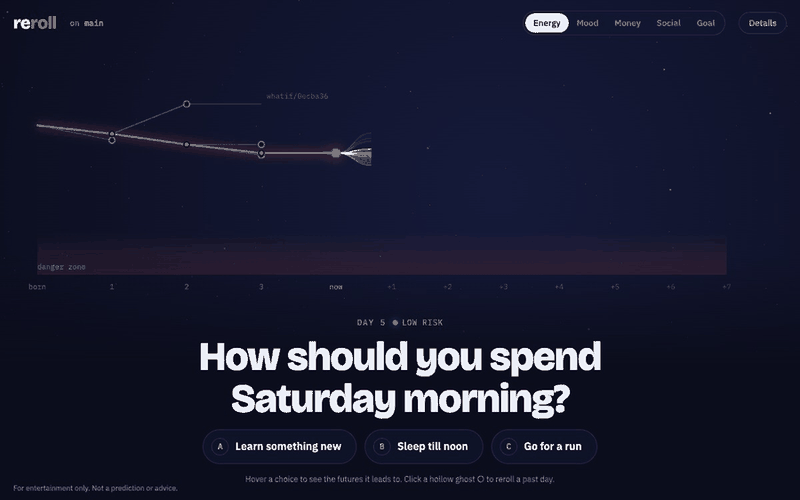
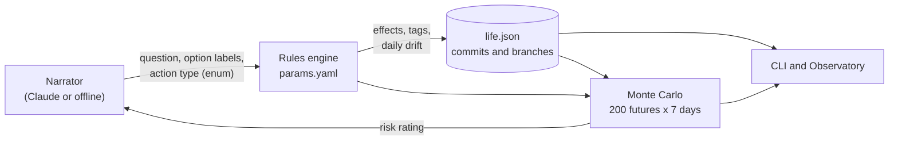

# Reroll

**English** | [简体中文](README.zh-CN.md)

[](https://github.com/cari0109/reroll/actions/workflows/tests.yml)

> `git log --graph`, but for your life.

<p align="center">
  
</p>

**[▶ Try it in your browser](https://cari0109.github.io/reroll/)** (no install; your life is saved only in your browser)

Every small decision is a commit. Every "what if" is a branch. The future is a cloud of simulated lives that collapses the moment you choose.

> **For entertainment only.** The numbers come from made-up rules. Nothing here is a prediction or advice.

## What you can do

- **Commit your day.** `life commit` gives you today's decision. The effects of each option stay hidden until you choose.
- **Reroll the past.** `life whatif <commit>` forks a branch just before an old decision and takes the option you skipped. You land exactly on its ghost.
- **See where you're headed.** Every state comes with 200 simulated futures. Habits snowball: three late nights in a row cost more than one.
- **Get roasted.** A speedrun commentator reacts to every choice. It's written by Claude if you have an API key, and offline templates otherwise.

## Quick start

```bash
git clone https://github.com/cari0109/reroll && cd reroll
python3 -m venv .venv && source .venv/bin/activate
pip install -e .

life init            # or: life init --lang zh
life commit          # face today's decision
life serve           # open the Observatory in your browser
```

Optional: `export ANTHROPIC_API_KEY=...` to let Claude write the decisions and commentary. Without it, everything runs offline.

## Commands

| Command | What it does |
|---|---|
| `life init [--lang en\|zh]` | Start a new life in `life.json` |
| `life commit ["your own question"]` | Make today's decision |
| `life commit "Tonight?" -o "Go hiking" -o "Watch a movie:rest"` | Write your own options; types are guessed unless you add `:type` |
| `life commit "Pet the cat?" -o "Yes:mood+,energy-" -o "No"` | No type fits? Say which stats go up or down; the rules set the amounts |
| `life log` / `life log --graph` | History with ghost options / every branch as a graph |
| `life status` | Current stats, active habits, 7-day outlook |
| `life forecast [-d 30]` | Simulated futures drawn as probability bands |
| `life whatif <commit>` | Redo a past day with the option you skipped |
| `life branch` / `life checkout -b <name> <commit>` | Parallel lives, git style |
| `life serve` | The Observatory web UI |

```text
* 2a1dc03 (HEAD -> what-if) Day 4 [low] Empty the cart  That thing in your cart …
│ * b10aa78 (main) Day 4 [low] Buy it  That thing in your cart just went on sale
* │ fecb702 Day 3 [low] Cook at home and save  Friends invited you to hotpot…
│ * 06ff31b Day 3 [low] I'm in!  Friends invited you to hotpot on Friday night
* │ d25c138 Day 2 [low] Lights out  It's 1 a.m. One more episode?
│ * 0ecba36 Day 2 [low] One more episode  It's 1 a.m. One more episode?
├─┘
* 1ce4e61 Day 1 [low] Hit the gym  Gym tonight, or stay late at work?
○ born
```

## How it works



### Design principles

1. **The narrator tells the story; the rules engine keeps the books.** Claude writes text and picks an action type from a fixed table. That choice is constrained by a JSON-schema enum and validated again with pydantic. Every number is rolled by code. Invalid or cut-off output is retried; API errors and refusals fall back to the offline narrator, so a commit never fails because of the model.
2. **Same physics everywhere.** Real commits, `whatif` replays and the simulation all use the same start-of-day step and action table. Effects are seeded from (HEAD, day, decision), so taking a ghost on a new branch reproduces its exact numbers.
3. **Hidden until observed.** The web API never sends today's effects before you choose. Hovering an option shows futures that start with its action type, with the effect re-rolled in every run.
4. **Every parameter is explicit.** Stats, actions, tag effects, drift and simulation weights live in [`params.yaml`](src/reroll/params.yaml), each labeled as an assumption.
5. **Full context on every call.** The narrator gets the current state, active habits and recent history each time. Nothing relies on the model remembering.

### The model, briefly

- **Stats:** energy, mood, money (financial health, not an amount), social and goal, each 0–100.
- **Actions:** 12 types (exercise, overtime, stay up, socialize, save, impulse buy, study, rest, chores, family, hobby, outing), each with an effect range per stat. When none fits, a **custom** type takes the directions you choose (e.g. mood up, energy down) and a fixed, moderate range from `params.yaml`.
- **Habits:** actions leave tags. While a tag is active it has a daily aftershock (`late_night ×2` costs 6 energy) and makes the same action more likely in simulated futures.
- **Daily drift:** you recover some energy overnight, while mood and social life fade a little unless you tend to them.
- **Forecast:** 200 runs over 7 days. Each simulated day picks an action weighted by your own history on this branch, active habits, and low-stat rules (tired people rest). The risk rating is the share of futures where energy, mood, money or social drops below 20.

## Development

```bash
pip install -e ".[dev]"
pytest
```

```text
src/reroll/
  models.py           life.json schema (pydantic)
  params.yaml         every rule and number, as assumptions
  rules.py            pure state transitions
  sim.py              Monte Carlo forecast
  ops.py              commit / branch / whatif logic
  narrator.py         narrator interface + offline narrator
  claude_narrator.py  Claude narrator: structured output, validation, fallback
  server.py           FastAPI for the Observatory
  web/                canvas frontend (no build step)
  cli.py, i18n.py     the `life` command, English and Chinese
```

## Roadmap

- [x] CLI with branches, ghosts and `whatif`
- [x] Claude narrator with schema-constrained output
- [x] Monte Carlo forecast and habit aftershocks
- [x] Observatory web UI
- [x] Write your own options (auto-classified into action types, editable)
- [x] "Multiverse remote": a branch switcher (`[` / `]`) where the old timeline fades into a ghost and the new one lights up
- [x] [Hosted demo](https://cari0109.github.io/reroll/): the same Python package running in your browser via Pyodide

## License

[MIT](LICENSE)
