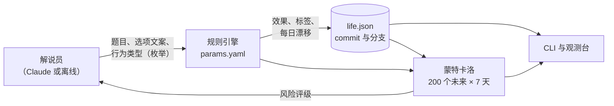

# Reroll

[English](README.md) | **简体中文**

[](https://github.com/cari0109/reroll/actions/workflows/tests.yml)

> `git log --graph`，但管理的是你的人生。

<p align="center">
  
</p>

每个决定是一次 commit，每个"如果当初"是一条分支。未来是一团模拟出来的人生，在你做出选择的那一刻坍缩成现实。

> **仅供娱乐。** 所有数字都来自编出来的规则，不构成任何预测或建议。

## 可以做什么

- **提交今天。** `life commit` 给出今天的决定。做出选择之前，每个选项的效果都是隐藏的。
- **重来过去。** `life whatif <commit>` 会在某个旧决定之前开一条分支，换成当时没选的选项。结果和那个"幽灵"完全一致。
- **看见未来的走向。** 每个状态都附带 200 个模拟的未来。习惯会累积：连续熬三晚的代价比熬一晚大得多。
- **被解说员吐槽。** 每个选择都会收到一段速通解说。有 API key 时由 Claude 来写，没有时使用离线模板。

## 快速开始

```bash
git clone https://github.com/cari0109/reroll && cd reroll
python3 -m venv .venv && source .venv/bin/activate
pip install -e .

life init --lang zh  # 中文；不加 --lang 默认英文
life commit          # 面对今天的决定
life serve           # 在浏览器里打开观测台
```

可选：`export ANTHROPIC_API_KEY=...`，让 Claude 来写决策和解说。不设置也能完全离线运行。

## 命令

| 命令 | 作用 |
|---|---|
| `life init [--lang en\|zh]` | 在 `life.json` 里开始一段新人生 |
| `life commit ["你自己的问题"]` | 做出今天的决定 |
| `life commit "今晚干嘛" -o "去爬山" -o "看电影:rest"` | 自己写选项；不加 `:类型` 时自动识别 |
| `life log` / `life log --graph` | 带幽灵选项的历史 / 所有分支的图 |
| `life status` | 当前状态、活跃习惯、7 天展望 |
| `life forecast [-d 30]` | 把模拟的未来画成概率带 |
| `life whatif <commit>` | 用当时没选的选项重来某一天 |
| `life branch` / `life checkout -b <名字> <commit>` | 平行人生，git 的用法 |
| `life serve` | 观测台网页 |

## 工作原理



### 设计原则

1. **大模型负责叙事，规则引擎负责记账。** Claude 只写文案，并从一张固定的行为表里选行为类型。这个选择受 JSON schema 的枚举约束，返回后再用 pydantic 校验一遍。所有数值都由代码决定。输出格式不对或被截断时会重试；遇到 API 错误或模型拒答，会退回离线解说员。所以 commit 永远不会因为模型出问题而失败。
2. **同一套物理规律。** 真实 commit、`whatif` 重放和模拟都使用同一个"每天开始"的步骤和同一张行为表。效果数值由 (HEAD, 天数, 决定) 确定，所以在新分支上选择幽灵选项，得到的数值和当初显示的完全一样。
3. **观测之前不可见。** 网页接口在你做出选择之前，绝不发送今天选项的效果。悬停时看到的，是"以这类行为开头"的未来，每一次模拟都会重新抽取效果。
4. **所有参数都是显式的。** 指标、行为、标签效果、每日漂移和模拟权重都写在 [`params.yaml`](src/reroll/params.yaml) 里，每一项都标注为假设值。
5. **每次调用都传入完整上下文。** 解说员每次都会拿到当前状态、活跃习惯和最近的历史，不依赖模型"记得"什么。

### 模型简介

- **指标：** 精力、心情、财务（财务健康度，不是金额）、社交、目标，范围都是 0–100。
- **行为：** 8 种（运动、加班、熬夜、社交、省钱、冲动消费、学习、休息），每种对每个指标都有一个效果区间。
- **习惯：** 行为会留下标签。标签生效期间，每天会产生余波（`late_night ×2` 每天额外扣 6 点精力），也会让模拟的未来里更常重复这个行为。
- **每日漂移：** 每晚会恢复一些精力；心情和社交如果不去维护，会慢慢回落。
- **预测：** 模拟 200 次、每次 7 天。模拟中每天选什么，按三方面加权：你在这条分支上的历史、当前的习惯、低数值时的规则（累了就更想休息）。风险评级 = 精力、心情、财务或社交跌破 20 的未来所占的比例。

## 开发

```bash
pip install -e ".[dev]"
pytest
```

## 路线图

- [x] 带分支、幽灵和 `whatif` 的 CLI
- [x] 输出受 schema 约束的 Claude 解说员
- [x] 蒙特卡洛预测和习惯余波
- [x] 观测台网页
- [x] 自己写选项（自动归类到行为类型，可修改）
- [ ] "多重宇宙遥控器"：切换分支时的转场效果
- [ ] 在线演示

## 许可证

[MIT](LICENSE)
